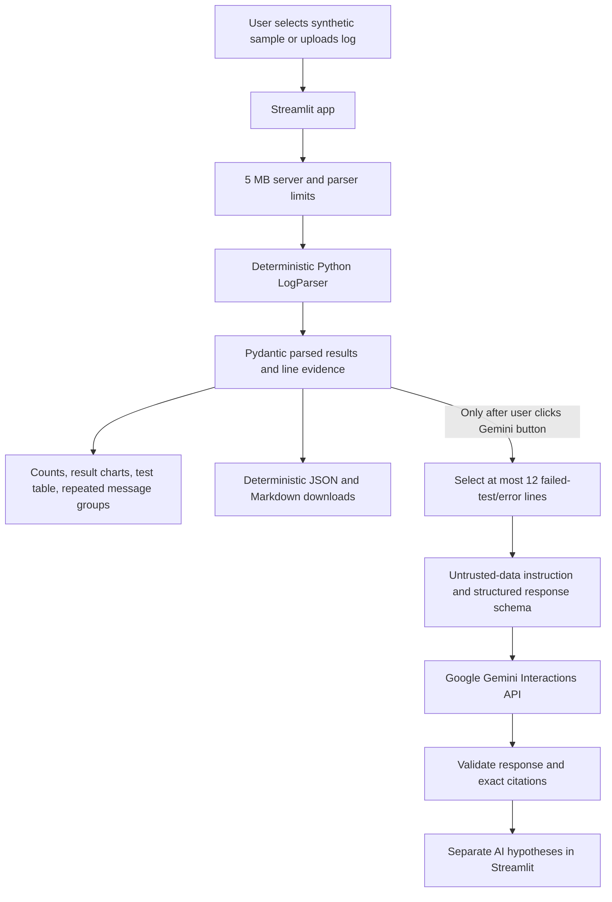

# RegressAI

AI-Powered Log Analyzer & Regression Failure Assistant

RegressAI is a local-first demonstration tool for turning a text-based software
test log into a compact, evidence-based failure report. It combines deterministic
Python parsing with an optional Gemini diagnosis. It is an interview and learning
project, not a replacement for production test infrastructure or semiconductor
verification tools.

## Problem and motivation

Automated test runs can produce long logs containing test outcomes, warnings,
timeouts, and repeated errors. An engineer investigating a failed run must search
those logs to find which tests failed and which messages might be relevant.
RegressAI automates this first triage step: it extracts supported test results
and log messages, groups repeated messages, and keeps the original line numbers
so a person can return to the source evidence.

## Implemented features

- Streamlit interface to select one of three synthetic sample logs or upload a
  UTF-8 `.log` or `.txt` file.
- Deterministic recognition of lines such as `TEST <name>: PASS/FAIL`, common
  error and warning severity labels, timestamps in `[HH:MM:SS]` form, and lines
  containing the word `timeout`.
- Separate test-result and error-message counts. A failed test is not counted as
  an error message, and a test may have multiple supporting error messages.
- Exact original line numbers and text for extracted results and messages.
- Deterministic grouping of repeated messages (case-insensitive message matching).
- Built-in result charts comparing passed and failed tests, plus extracted errors
  and warnings. These summarize the selected log; they are not historical trends.
- JSON and Markdown reports containing deterministic results and evidence.
- Optional, button-triggered Gemini diagnosis through Google's `google-genai`
  SDK and Interactions API. The response includes a summary, cited log evidence,
  possible causes, debugging steps, and missing information.
- AI output is displayed separately from deterministic results and is not added
  to report downloads.
- A 5 MB upload limit in the Streamlit server configuration and parser.
- Mocked tests for parser, reports, and Gemini request/error behavior.

## Architecture



The normal analysis path does not call Gemini. API results are not part of the
deterministic report files.

## Technology choices

| Technology | Use in this project |
|---|---|
| Python 3.11+ | Parsing, data models, reports, and Gemini client are implemented in one language. |
| Streamlit | Provides a small interactive Python UI without maintaining a separate frontend/backend. |
| Regular expressions | Recognize the handful of documented test, severity, timestamp, and timeout patterns. |
| Pydantic 2 | Defines parsed result structures and validates the structured Gemini response. |
| `google-genai` | Official Google GenAI Python SDK used for Gemini API calls. |
| `python-dotenv` | Loads a local `.env` when present; environment variables can also be provided by the shell or host. |
| pytest | Runs deterministic and mocked integration tests without a Gemini account or network request. |
| JSON and Markdown | Simple structured and readable report download formats. |

## Project structure

```text
RegressAI/
├── .env.example                 # Placeholder-only configuration template
├── .gitignore                   # Excludes credentials, virtual environments, caches
├── .streamlit/
│   └── config.toml              # Streamlit upload limit (5 MB)
├── README.md
├── app.py                       # Streamlit user interface
├── requirements.txt
├── analyzer/
│   ├── __init__.py
│   ├── parser.py                # Deterministic parsing and data models
│   ├── reports.py               # JSON and Markdown exports
│   └── ai_assistant.py          # Optional evidence-limited Gemini client
├── sample_logs/
│   ├── successful_run.log
│   ├── failed_run.log
│   └── repeated_errors.log
└── tests/
    ├── test_ai_assistant.py
    ├── test_parser.py
    └── test_reports.py
```

## Windows installation and setup

Open PowerShell in the project directory:

```powershell
cd D:\RegressAI
py -3.11 -m venv .venv
.\.venv\Scripts\Activate.ps1
python -m pip install -r requirements.txt
```

If the Python launcher is unavailable, use an installed Python 3.11+ executable:

```powershell
python -m venv .venv
```

If PowerShell prevents environment activation, either use the Python executable
directly (`.\.venv\Scripts\python.exe`) or adjust the execution policy for your
user according to your organization's policy.

## Run without an API key

No Gemini key is needed for deterministic parsing or report downloads:

```powershell
.\.venv\Scripts\streamlit.exe run app.py
```

Choose **Sample log** or **Upload a log** in the sidebar. Deterministic counts,
test results, grouped messages, and JSON/Markdown download buttons are available
without credentials. Clicking the Gemini button without a configured key shows a
clear message; it does not make a Gemini request.

## Configure Gemini securely

Gemini is optional and is only called after clicking **Ask Gemini for diagnostic
hypotheses**. First create a local `.env` from the placeholder template:

```powershell
Copy-Item .env.example .env
notepad .env
```

Replace the placeholder values in `.env`:

```dotenv
GEMINI_API_KEY=your_actual_key_from_google_ai_studio
GEMINI_MODEL=gemini-3.8-flash
```

Create a key in [Google AI Studio](https://aistudio.google.com/api-keys). The
default model name `gemini-3.8-flash` is listed in Google's
[official Gemini model guide](https://ai.google.dev/gemini-api/docs/models).
Model access may vary by account, project, or API availability; if Google rejects
it, check the official model list and your key's access, then set an available
model in `.env`.

Security reminders:

- Never paste a real key into `.env.example`, source code, screenshots, chat, or
  a committed file. `.env` is ignored by Git; `.env.example` is not.
- If a real key is ever placed in a shared or tracked file, revoke/rotate it in
  Google AI Studio. Removing it from the current file does not invalidate a
  previously exposed credential.
- The Gemini request sends up to 12 selected failed-test/error lines, capped at
  500 characters per line. It does not send warnings or unrelated log lines.
- Log text is untrusted and may contain secrets. The request tells the model to
  treat logs as data, but that instruction is not a security boundary. Only send
  log evidence you are permitted to share with Google.
- The request sets `store=False` to opt out of server-side interaction history.
  This is not a promise about all service-level processing or retention; review
  Google's current data terms for your account.
- AI causes and debugging suggestions are hypotheses, not verified root causes.

## Run automated tests

From PowerShell:

```powershell
.\.venv\Scripts\python.exe -m pytest -q
```

The Gemini tests replace the SDK client with mocks and disable local `.env`
loading. They do not contact Google and do not need an API key.

## Synthetic samples and example output

All included sample logs are synthetic:

- `successful_run.log`: four tests pass; no failures.
- `failed_run.log`: four tests, with two passing and two failing, plus error and
  warning messages including a timeout.
- `repeated_errors.log`: one pass and one failure, with a repeated DMA cleanup
  error and a warning.

For `repeated_errors.log`, the deterministic summary is:

```text
Tests: 2 | Passed: 1 | Failed: 1 | Errors: 3 | Warnings: 1
ERROR group: "DMA descriptor was not released"
Occurrences: 3 | Original lines: 2, 3, 5
```

This illustrates why test failures and error-message occurrences have separate
counts.

## Limitations and future improvements

Current limitations:

- Parsing is regex-based and supports only the documented text patterns; it is
  not a general-purpose parser for arbitrary test frameworks.
- Grouping is based on identical normalized messages, not semantic similarity.
- The Gemini request is limited to extracted failed-test/error evidence and may
  omit relevant context from a larger log.
- AI output can be wrong, incomplete, or overconfident despite schema and
  citation checks.
- Tests use a mocked Gemini client. They validate request construction and
  failure handling, not successful live API access or account-specific model
  availability.
- This demonstration is not production-ready; it has no authentication,
  multi-user support, persistent analysis history, or deployment hardening.

Possible next improvements:

1. Add parsers for JUnit XML, TAP, and specific test-runner formats.
2. Add configurable evidence selection and optional surrounding-line context.
3. Add unit tests for Streamlit UI interactions and upload boundary behavior.
4. Add report metadata (parser version, creation time) and an explicit AI
   section only when the user requests and accepts it.
5. Add CI, dependency pinning/lock file, and deployment/security review.

## License and project status

This is a demonstration project for interview preparation. Do not describe it as
a production tool or claim performance or deployment results that have not been
measured.
